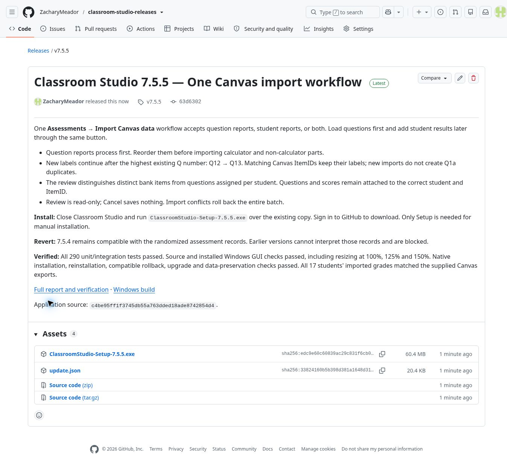

# Classroom Studio 7.5.5 — unified Canvas import

## Request and resulting behavior

One **Assessments → Import Canvas data** workflow replaces the separate student-score and item-tag entry points. Teachers can import question metadata first, import scores later, or select all reports together. Question reports run first regardless of selection order. Their relative order can be changed in the review screen.

New items receive continuous labels after the highest existing Q number, including legacy suffixes: an existing Q12 or Q12a leads to Q13. Existing ItemIDs retain their labels and scores. Old labels are not silently renamed. Duplicate titles never merge distinct ItemIDs.

The review shows each file's distinct bank-item count, student count and assigned-item range where available. Shared labels identify bank items, not positions in individual randomized quizzes. Existing questions that lack a Canvas ItemID still need an explicit identity link before an import can match them; titles alone are not sufficient evidence.

## Data safeguards

- Question-first creation requires ItemID, positive finite PossiblePoints and ItemType. Actual metadata confirms maxima; a highest earned score is never substituted for confirmed points.
- Student results match by Canvas student ID and ItemID, preserving randomized assignment statuses. Not Attempted is excluded, No Answer is zero, and ungraded work remains pending.
- One shared-roster review deduplicates the same students across calculator and non-calculator files. Contradictory identities or repeated attempts within a report are rejected.
- Preview uses a disposable local database copy. Cancel leaves imported data unchanged. A revision check rejects stale previews.
- The entire batch, including roster changes, commits together or rolls back together on any conflict. The existing recovery copy before the first randomized import remains in place.
- No schema migration; 7.5.4 remains compatible for rollback. The previous 7.5.4 reader was checked against the newly imported supplied exports: grades, assigned counts and completion matched, with all 272 graded responses retained. Earlier versions still cannot interpret saved randomized assignment records.

## Verification

Local static checks and all 290 unit/integration checks passed, including 13 new regressions for ordering, numbering, stable item identity, points, preview cancellation, stale review, roster reuse and transaction rollback. The source GUI workflow and dependency audit passed before native verification. Native verification exposed a Windows Configure-event error: the dialog attempted to read widget scaling from a window. It now uses the label’s own scaling, and the GUI check explicitly resizes the dialog after construction at 100%, 125% and 150%. The corrected source GUI check and both native Windows runs passed all 10 randomized/unified-import checks without callback errors. Native installation, reinstallation, signed compatible rollback, upgrade after rollback, uninstall and database-preservation checks all passed.

The four supplied exports were tested locally without publishing student records. Both question-first/later-score imports and a four-report batch produced the same grades as Canvas for all 17 students. Reimport added no duplicate items. Combined results: 57 distinct bank items, 16 assigned items per student and 272 graded responses.

| Part | Distinct items | New labels in an empty assessment | Assigned per student |
|---|---:|---|---:|
| Non-calculator | 30 | Q1–Q30 | 12 |
| Calculator | 27 | Q31–Q57 | 4 |

The Q13 example applies when the existing bank actually ends at Q12. These particular randomized exports contain 30 non-calculator bank items, so calculator items begin at Q31. The CSVs do not establish each student's original on-screen question positions.

## Use

1. Open an assessment and choose **Import Canvas data → Add reports**.
2. Select question reports first, or select question and student reports together.
3. Put question reports in the desired order with Move up/down.
4. Choose **Review import**, inspect numbering and counts, then **Import reviewed data**.
5. If only questions were imported, return to the same button when student results are available.

Existing labels and published gradebook values are preserved. Publishing assessment results still requires the existing grade preview.

## Build and evidence

- Application source: `c4be95ff1f3745db55a763dded18ade8742854d4`.
- [Source tests, GUI smoke and dependency audit](https://github.com/ZacharyMeador/classroom-studio/actions/runs/44082684609).
- [Windows build and native lifecycle checks](https://github.com/ZacharyMeador/classroom-studio/actions/runs/44082684541).
- [Aggregate supplied-export verification](verification_7_5_5/supplied-export-checks.json).
- [7.5.4 randomized-data compatibility](verification_7_5_5/rollback-compatibility.json).
- [Source GUI checks](verification_7_5_5/source-smoke.json) and [dependency audit](verification_7_5_5/dependency-audit.json).

The native rollback gate uses a signed 7.4.2 installer with compatible, fictional, non-randomized records. This does not allow a randomized workspace to downgrade below 7.5.4. The separate 7.5.4 compatibility check uses the newly imported randomized exports and confirms the same grades and assignment counts.

Downloaded release artifact integrity, update-manifest signature, installer checksum/size and portable-archive contents were independently verified before publication.

- [Native install](verification_7_5_5/install-smoke.json), [reinstall](verification_7_5_5/reinstall-smoke.json), [compatible rollback](verification_7_5_5/rollback-smoke.json) and [Windows lifecycle checks](verification_7_5_5/windows-verification.json).
- [Asset hashes and signature verification](verification_7_5_5/asset-verification.json).
- Installer SHA-256: `edc9e60c60839ac29c831f6cb07771c7a834d0350029697e1e4e68c4c1e7268e`.

## Installation

Download `ClassroomStudio-Setup-7.5.5.exe` from the signed-in GitHub release page, close Classroom Studio, and run Setup over the existing installed copy. Confirm 7.5.5 in the app after reopening. The private release channel requires a manual signed-in download; this publication does not update a teacher’s computer by itself.

Published as the latest release on November 17, 2026: [Classroom Studio 7.5.5](https://github.com/ZacharyMeador/classroom-studio-releases/releases/tag/v7.5.5). GitHub’s uploaded asset sizes and SHA-256 digests match the independently verified local files. [Publication evidence](verification_7_5_5/publication.json).

